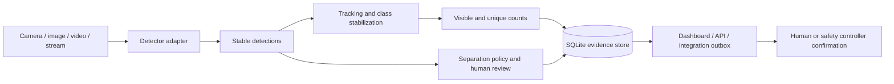

# Edge Litter Detection

[](https://github.com/biolababs/edge-litter-detection/actions/workflows/ci.yml)
[](https://github.com/biolababs/edge-litter-detection/actions/workflows/security.yml)
[](https://www.python.org/)
[](LICENSE)

Portable real-time litter detection, multiclass classification, tracking, and
counting for cameras, cleanup vehicles, fixed monitoring points, and recycling
lines.

The application works from a clean clone with public visual models—no API key,
private checkpoint, or user training is required. It accepts an attached
camera, image, video, HTTP source, or RTSP stream; shows an operations
dashboard; and stores durable evidence in SQLite.

> Project status: functional open-source application under active validation.
> Public models make the complete workflow usable today. A coexistence test on
> Jetson Orin Nano 8 GB completed the full video, persistence, dashboard, and
> API paths. Production accuracy, high-rate throughput, and endurance still
> require representative data and deployment-specific acceptance.

## Research preprint

The accompanying systems and reproducibility paper documents the architecture,
count semantics, human and machinery-safety boundaries, preliminary engineering
evidence, and the frozen protocol for target-domain and edge-device validation:

- [PDF preprint](paper/Edge_Litter_Detection_Preprint.pdf)
- [editable manuscript](paper/edge_litter_detection_preprint.md)
- [ResearchGate submission record](paper/RESEARCHGATE_SUBMISSION.md)

The manuscript cites software version `0.10.1` at Git commit
`756fa2ae0b8686bb4b97940911710dc73f8efd90`. It is a preprint and must not be
described as peer reviewed. Preliminary Jetson functionality, throughput,
memory, temperature, and whole-device power have been measured; accuracy,
count-error, endurance, AMD, and field-outcome results remain pending their
declared evaluations.

## What the solution provides

- detection boxes, stable litter class names, and confidence scores;
- current visible counts and unique tracked counts for a run;
- 16 configurable litter categories and site-specific separation guidance;
- browser control for live cameras, videos, and network streams;
- SQLite runs, counts, human-review records, collection confirmations, and an
  integration outbox;
- annotated media plus JSONL and JSON operational evidence;
- CPU, NVIDIA CUDA, AMD ROCm, Apple MPS, and Jetson-oriented deployment paths;
- an optional COCO training workflow for site-specific improvement; and
- one automated launcher for normal use.

This is a litter solution, not a YOLO demonstration or model leaderboard. The
detector is an interchangeable adapter behind the same tracking, counting,
storage, review, and integration contracts.

## Five-minute start

Requirements: 64-bit computer, Python 3.10–3.14, 8 GiB memory, 10 GiB free
storage, and internet access for the first installation and model download.

```bash
git clone https://github.com/biolababs/edge-litter-detection.git
cd edge-litter-detection
./startup.sh --backend omdet_turbo --demo-video --no-display
```

The command creates `.venv`, installs dependencies, downloads an attributed
recycling-facility video and an immutable public model revision, processes the
video, and writes:

```text
state/litter-edge.db                  SQLite operational store
reports/generated/run-*.jsonl        per-frame events
reports/generated/run-*-summary.json run evidence
reports/generated/run-*-annotated.*  annotated image or video
```

Inspect the result:

```bash
.venv/bin/python query_counts.py runs --limit 1
.venv/bin/python query_counts.py summary
```

Run `./startup.sh --help` for all options.

## Operations dashboard

Prepare the sorting-floor demonstration and start the dashboard:

```bash
./startup.sh \
  --dashboard \
  --demo-video \
  --backend omdet_turbo \
  --device auto
```

Open `http://127.0.0.1:8088`, choose **Use sorting-floor demo**, and start the
session. The dashboard shows the annotated feed, visible and unique counts,
recent runs, review queue, collection evidence, and source controls.

The service is local-only and has no built-in authentication. For a remote edge
device, keep the service on localhost and create a tunnel:

```bash
ssh -L 8088:127.0.0.1:8088 user@edge-device
```

Then open `http://127.0.0.1:8088` on your computer. Do not expose port 8088
directly to the public internet.

## Use a camera, image, video, or stream

```bash
# Attached camera
./startup.sh --source 0 --backend omdet_turbo

# Image
./startup.sh --source media/litter.jpg --backend omdet_turbo

# Downloaded video
./startup.sh --source media/sorting-line.mp4 --backend omdet_turbo --no-display

# Network camera or live stream
export LITTER_STREAM_URL="rtsp://camera-host/live"
./startup.sh \
  --source "$LITTER_STREAM_URL" \
  --backend omdet_turbo \
  --no-display

# Vehicle and route context
./startup.sh \
  --source 0 \
  --edge-device-id edge-truck-01 \
  --vehicle-id truck-12 \
  --route-id route-a
```

The launcher can automatically find an available camera or supported media
under `media/` when `--source` is omitted. Press `q` in the display window or
`Ctrl+C` in the terminal to stop a live run.

For a smaller image-only functional test:

```bash
./startup.sh --demo --no-display
```

Downloaded demonstrations retain source, creator, license, and checksum
metadata and remain excluded from Git.

## Classes and separation

The default operational taxonomy contains:

| Material or item | Material or item |
|---|---|
| `plastic_bottle` | `glass_bottle` |
| `metal_can` | `paper` |
| `cardboard` | `plastic_bag` |
| `food_wrapper` | `disposable_cup` |
| `cigarette_butt` | `food_waste` |
| `textile` | `tire` |
| `battery` | `electronic_waste` |
| `broken_glass` | `other_litter` |

Edit [config/classes.yaml](config/classes.yaml) to tune public-model prompts.
Edit [config/separation.yaml](config/separation.yaml) to map categories to the
operator's local material streams. Hazardous, ambiguous, and low-confidence
items can be routed to human review.

## Counting and SQLite

The application keeps distinct meanings:

- `visible_counts`: objects visible in the current frame;
- `unique_session_counts`: confirmed track IDs counted once during a run;
- `confirmed_collected_counts`: items independently confirmed as collected.

A detection is never automatically claimed as collected. Re-entry, long
occlusion, abrupt camera motion, and scene cuts can still duplicate tracks; see
[counting semantics](docs/COUNTING.md).

Query durable records:

```bash
.venv/bin/python query_counts.py summary
.venv/bin/python query_counts.py summary \
  --vehicle-id truck-12 \
  --route-id route-a
.venv/bin/python query_counts.py runs --limit 20
.venv/bin/python query_counts.py reviews --status pending
.venv/bin/python query_counts.py outbox
```

Per-detection database rows are disabled by default to control disk use. Enable
them only when required:

```bash
./startup.sh --persist-detections
```

## HTTP API

Start the dashboard, image detection, stream control, and operational APIs:

```bash
./startup.sh --api
```

Examples:

```bash
curl http://127.0.0.1:8088/healthz
curl http://127.0.0.1:8088/readyz

curl \
  -H "Content-Type: image/jpeg" \
  --data-binary @media/litter.jpg \
  http://127.0.0.1:8088/v1/detect

curl \
  -H "Content-Type: application/json" \
  -d '{"source":"0","edge_device_id":"edge-truck-01"}' \
  http://127.0.0.1:8088/v1/streams

curl "http://127.0.0.1:8088/v1/counts/summary?vehicle_id=truck-12"
```

Use `./startup.sh --counts-api` when only stored counts, reviews, collection
confirmations, and integration events are needed.

Image uploads accept JPEG, PNG, and WebP with byte, pixel, and concurrency
limits. Interactive OpenAPI pages are disabled by default. See
[deployment](docs/DEPLOYMENT.md) and [security](SECURITY.md).

## Hardware requirements

| Tier | CPU | Memory | Accelerator | Free storage | Intended use |
|---|---:|---:|---:|---:|---|
| Minimum functional | 4 logical cores | 8 GiB | Optional | 10 GiB | Setup, images, integration, low-rate processing |
| Real-time evaluation | 6+ logical cores | 16 GiB host | 8 GiB+ | 20 GiB | Camera or stream acceptance testing |

These are planning baselines, not guaranteed frame rates. Current platform
status:

| Platform | Status |
|---|---|
| CPU | Functional reference path |
| NVIDIA CUDA | Functional; Tesla T4 smoke and model benchmark completed |
| Jetson Orin 8 GB | Full workflow verified; 5.54 detector FPS and 4.94 FPS across a 3,622-frame full-file stability run |
| AMD ROCm / Ryzen AI Max / Strix Halo | Runtime path implemented; target validation pending |
| Apple silicon | MPS development path available; target validation pending |

See [hardware requirements](docs/HARDWARE_REQUIREMENTS.md) and the
[Jetson validation report](docs/JETSON_VALIDATION_2026-10-21.md) for measured
evidence, storage planning, and validation boundaries. The current Jetson path
does not meet the provisional 15 FPS target and must not be presented as an
accuracy or production-readiness result.

## Architecture



The software is a perception and evidence component. It must not directly move
a garbage-collection or sorting arm. Final actuation belongs to a safety-rated
controller with emergency stops, exclusion zones, interlocks, proximity
sensing, and stale-signal handling. See
[cleanup-truck integration](docs/TRUCK_INTEGRATION.md).

## Models and training

Normal users do not train:

| Backend | Purpose | Training required | Status |
|---|---|---:|---|
| OmDet-Turbo Tiny | Compact public open-vocabulary operation | No | Integrated |
| Grounding DINO Tiny | Public bootstrap and prompt configuration | No | Integrated |
| RF-DETR Nano | Future litter-specific release checkpoint | Maintainers only | Release pending |

The two public Transformers defaults are pinned to immutable Hugging Face
commits, use SafeTensors, and disable remote model code. A custom remote model
must use `owner/model@40-character-commit`; reviewed local model directories are
also accepted.

Optional site-specific improvement uses a COCO detection dataset:

```bash
python3 -m venv .venv-train
source .venv-train/bin/activate
python -m pip install -e ".[runtime,train]"

python train.py \
  --data data/my-litter-v1 \
  --model rfdetr-nano \
  --device cuda \
  --epochs 100 \
  --batch 4 \
  --name my-litter-v1
```

Follow [training with your own data](docs/TRAINING_YOUR_DATA.md). Training is an
improvement and release workflow, not an installation prerequisite.

## Containers and edge deployment

The included Compose deployment is a CPU reference:

```bash
docker compose build
docker compose up
```

It runs as a non-root user, persists SQLite state and the model cache, and
publishes the dashboard only on `127.0.0.1:8088`.

For NVIDIA, AMD, or Jetson, first install or select the vendor-supported
PyTorch environment:

```bash
LITTER_PYTHON=/path/to/vendor/environment/bin/python \
  ./startup.sh --source 0 --device auto
```

The launcher refuses to create a generic first-time PyTorch environment on a
detected Jetson because that could conflict with JetPack. The shared Jetson used
for validation was tested through a pinned, constrained container without
changing its system Python, system packages, power mode, clocks, or existing
services.

## Development and validation

```bash
make validate
```

Security checks:

```bash
python -m pip install -e ".[dev]"
make security
```

CI runs the unit, launcher, release-validation, Ruff, Bandit, and build checks.
CodeQL, dependency review, and Dependabot are configured separately.

The repository intentionally excludes runtime media, databases, generated
reports, datasets, and model weights. Empty `.gitkeep` placeholders are not
used; required directories are created at runtime.

## Documentation

- [Documentation index](docs/README.md)
- [Architecture](docs/ARCHITECTURE.md)
- [Deployment](docs/DEPLOYMENT.md)
- [Hardware requirements](docs/HARDWARE_REQUIREMENTS.md)
- [Security review](docs/SECURITY_REVIEW.md)
- [Input sources](docs/INPUT_SOURCES.md)
- [Counting semantics](docs/COUNTING.md)
- [Integration events](docs/INTEGRATION_EVENTS.md)
- [Training with your own data](docs/TRAINING_YOUR_DATA.md)
- [Software and MSc research separation](docs/SOFTWARE_AND_RESEARCH.md)

## Contributing, support, and license

Read [CONTRIBUTING.md](CONTRIBUTING.md), the
[code of conduct](CODE_OF_CONDUCT.md), and [SUPPORT.md](SUPPORT.md) before
opening a pull request or issue. Report vulnerabilities privately according to
[SECURITY.md](SECURITY.md).

Original project code and software documentation are licensed under
[Apache-2.0](LICENSE). Public models, datasets, downloaded demonstration media,
generated artifacts, and academic material can have separate licenses; review
[LICENSE-NOTICE.md](LICENSE-NOTICE.md).

Citation metadata is available in [CITATION.cff](CITATION.cff).
