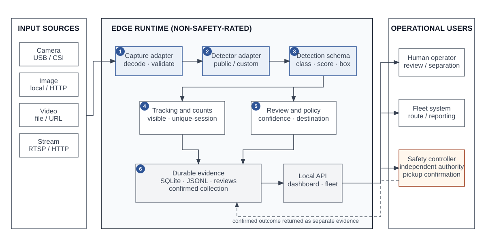
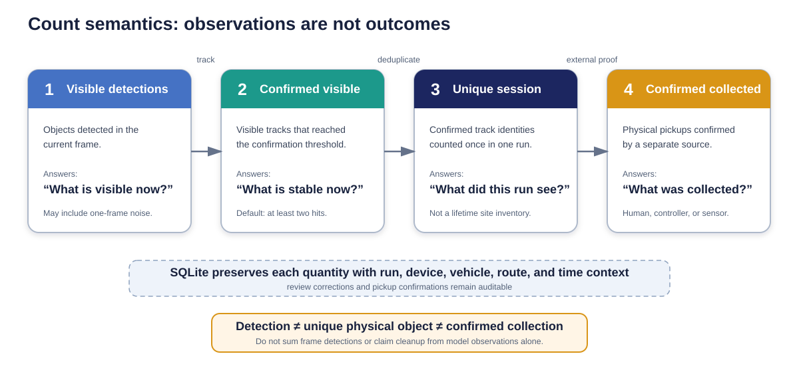
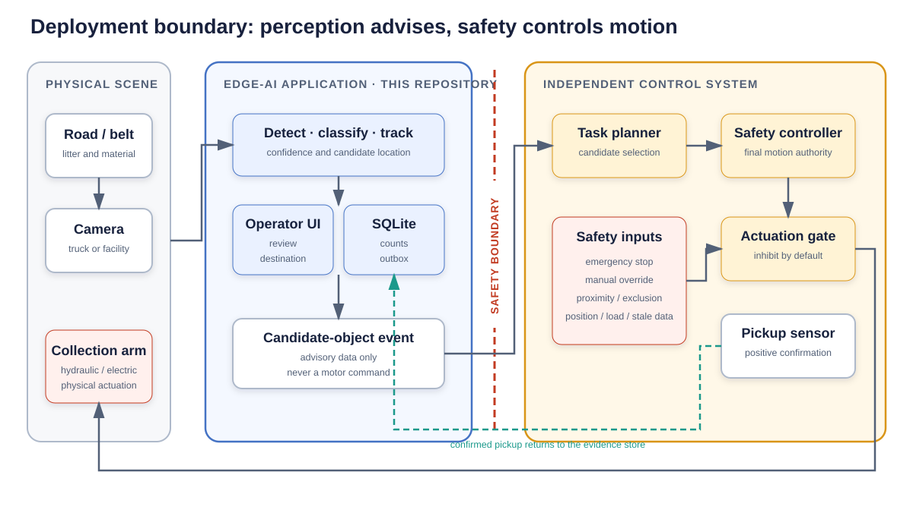
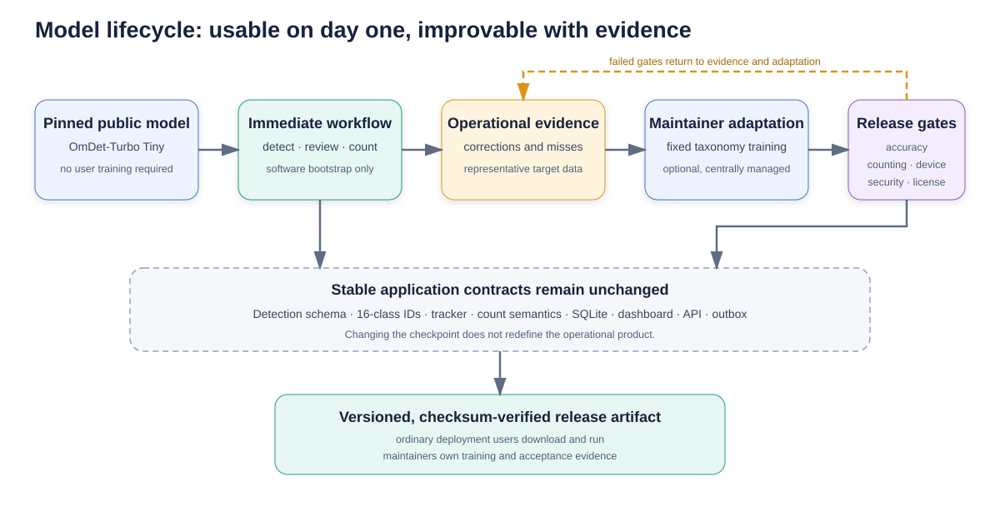
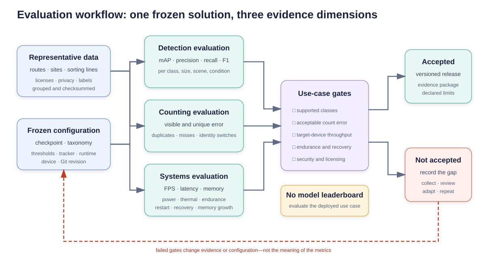
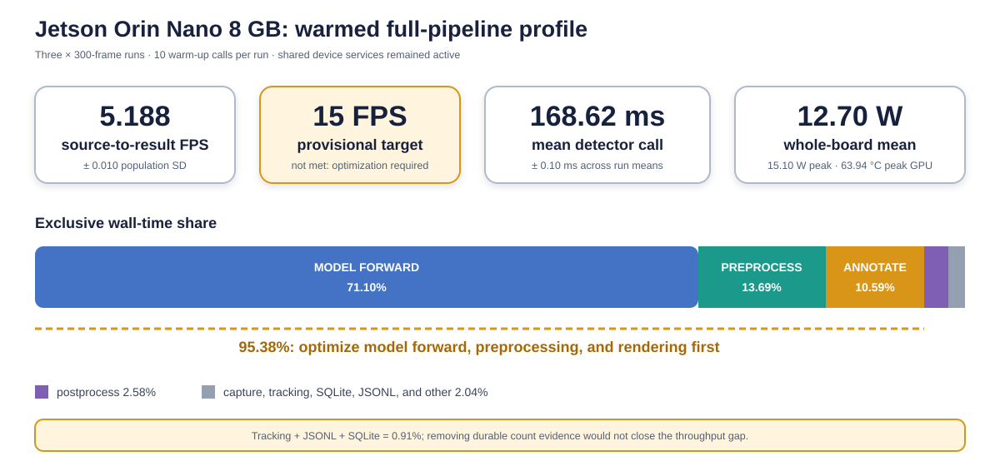

# An Open and Reproducible Edge-AI Software Architecture for Litter Detection, Multiclass Classification, Tracking, and Counting

Abiola A. Babsalaam  
Independent Researcher  
Preprint version 1.3 — 21 October 2026

## Abstract

Litter monitoring is often treated as an object-detection exercise, although a
deployable solution must also ingest operational video, maintain stable class
contracts, avoid repeated counting, persist evidence, support human review, and
integrate safely with collection or sorting workflows. This paper presents an
open and reproducible edge-AI software architecture that addresses those
requirements as one portable application. The software accepts cameras,
images, recorded video, HTTP media, and RTSP streams; normalizes public or
custom detector output; applies duplicate suppression and class-stabilized
tracking; reports visible and unique-session counts; and stores auditable
SQLite and JSON evidence. A browser interface exposes annotated video, counts,
review tasks, and source controls. The default 16-class operational taxonomy
supports human review and configurable separation guidance.

The detector is interchangeable rather than the product boundary. A clean
clone runs with the public OmDet-Turbo Tiny open-vocabulary checkpoint, while a
validated litter-specific checkpoint can be introduced later without changing
downstream contracts. A preliminary zero-shot evaluation on a deterministic,
source-grouped TACO test partition of 212 images and 680 mapped annotations
measured 7.65% COCO mAP50–95, 10.16% mAP50, and 7.49% micro F1 at the frozen
operating point. This result establishes an accuracy signal and also shows that
the unadapted public checkpoint is a functional bootstrap, not a
production-accepted litter model.

Engineering validation confirms installation, inference, persistence,
automated checks, and execution on NVIDIA CUDA, Apple silicon, and an NVIDIA
Jetson Orin Nano 8 GB. A prior complete 3,622-frame Jetson run measured
4.94 source-to-result FPS. Three subsequent 300-frame full-pipeline
repetitions, each after 10 warm-up calls, measured 5.188 ± 0.010 FPS. Model
forward time accounted for 71.10% of wall time, detector preprocessing 13.69%,
and annotation/output 10.59%; tracking, JSONL, and SQLite together accounted
for less than 1%. The provisional 15 FPS target was not met. These measurements
do not establish target-domain accuracy, counting error, endurance, AMD
performance, or production readiness. The contribution is therefore the
reusable architecture, explicit count semantics, safety and security boundary,
traceable preliminary evidence, and a protocol for the remaining empirical
work.

**Keywords:** edge AI; litter detection; waste classification; object tracking;
object counting; open-vocabulary detection; human-in-the-loop; NVIDIA Jetson;
recycling; reproducible software

## 1. Introduction

Improperly discarded waste affects public-space quality, drainage, wildlife,
and the movement of plastics into aquatic environments [1,2]. Collection teams
typically depend on scheduled routes, visual inspection, public reports, and
fixed infrastructure. These methods remain necessary, but they provide limited
continuous information about where litter is present, what material it may
contain, and whether an observed item was later collected.

Computer vision can provide an additional perception layer. A camera-equipped
vehicle, fixed monitoring point, or sorting line can produce candidate object
locations, predicted classes, confidence scores, and counts. Edge processing
can keep raw imagery close to the source and continue operating when network
connectivity is intermittent. However, a neural-network prediction alone is
not an operational solution. The surrounding application must handle cameras
and streams, normalize model output, preserve object identity across frames,
define what a count means, retain auditable evidence, support corrections, and
avoid unsafe coupling between uncertain perception and machinery.

Litter is also a difficult visual domain. Objects can be small, crushed,
transparent, reflective, wet, dirty, partly occluded, or visually similar to
permanent background objects. Material cannot always be inferred from
appearance. A clear container, for example, may not contain enough visible
evidence to distinguish glass from plastic. Public datasets demonstrate the
feasibility of litter detection but do not remove the need to validate the
intended camera, environment, class ontology, and operating threshold [3–6].

This work treats the outcome—reliable detection, classification, tracking,
counting, review, and integration—as the unit of design. It does not compare
model families or attempt to establish a leaderboard. The detector is placed
behind a stable adapter so the complete workflow can operate with a publicly
available model and later accept a validated site-specific checkpoint without
changing downstream data contracts.

The contribution is therefore a software-systems and reproducibility
architecture, not a new detector. This revision adds a preliminary public-data
accuracy result, but it is not a target-domain validation. The low zero-shot
result is reported because deployability requires both working software and an
honest model-acceptance boundary.

The result is the open-source Edge Litter Detection application [7]. A user can
clone the repository and run one launcher that prepares an isolated
environment, installs dependencies, downloads a pinned public model, discovers
or accepts a source, performs inference, and writes durable evidence. The same
application supports a local dashboard, a private HTTP API, SQLite queries,
human review, and integration events for a larger vehicle or facility system.

This paper is released as a systems and reproducibility preprint. It documents
the implemented design, a public-data zero-shot evaluation, and authorized
Jetson coexistence measurements while target-domain data, video count ground
truth, multi-hour endurance, and field outcomes remain pending. This
distinction is deliberate: public-data accuracy is not field accuracy, and a
short technical run is not proof of sustained operational performance.

### 1.1 Research questions

The work is organized around the following questions:

1. How can litter detection, multiclass classification, tracking, counting,
   storage, review, and integration be packaged as a reusable edge
   application?
2. Can the application operate immediately with a public model, without
   requiring every deployment user to collect data or train a network?
3. How should visible observations, unique tracked objects, and confirmed
   collections be represented so that operational reports do not overstate the
   outcome?
4. What reproducible protocol is required to evaluate detection accuracy,
   counting accuracy, throughput, memory, power, thermal behavior, and
   stability on the intended device?
5. What privacy, security, and machinery-safety boundaries are necessary when
   the system is used on a cleanup vehicle or sorting line?

### 1.2 Contributions

The principal contributions are:

- a portable, model-adapter-based application for image, camera, video, HTTP,
  and RTSP litter detection;
- a 16-class operational taxonomy with configurable prompts and separation
  destinations;
- tracking-based visible and unique-session counts, with independently
  confirmed collections stored as a separate quantity;
- an offline-first SQLite evidence model, review queue, browser dashboard, API,
  and durable integration outbox;
- one-command installation and execution using public, pinned model artifacts;
- deployment paths for CPU, NVIDIA CUDA, NVIDIA Jetson, AMD ROCm, and Apple
  silicon;
- model, data, privacy, security, and safety boundaries intended for reuse in
  real collection and sorting workflows; and
- a deterministic public-data zero-shot evaluation and a predeclared empirical
  protocol that prevent preliminary engineering observations from being
  reported as final target-domain results.

## 2. Related Work

### 2.1 Litter and waste datasets

TACO introduced a publicly available dataset of waste “in the wild,” with
object annotations and a detailed material-oriented taxonomy [3]. It is useful
for bootstrapping because it contains varied contexts rather than only
controlled conveyor imagery. Studies based on TACO have also highlighted the
difficulty of small objects, class imbalance, and the risk of reporting one
aggregate metric without examining precision, recall, F1, object size, and
scene conditions [4,5].

ZeroWaste focuses on industrial waste sorting and emphasizes dense,
overlapping objects and material recovery facility conditions [6]. It
illustrates why a sorting-line camera and a road-facing vehicle camera should
not automatically be treated as the same domain. More recent datasets such as
RoLID-11K expand real-world litter coverage and underline continuing interest
in diverse scenes and fine-grained categories [8]. Dataset growth is valuable,
but deployment performance still depends on the intended viewpoint, camera,
lighting, object size, contamination, motion, and taxonomy.

The present project therefore uses public data as attributed bootstrap
material rather than as proof of field performance. The repository can prepare
a grouped TACO-derived COCO dataset while retaining source and license
metadata. Target-domain samples remain necessary before a litter-specific
checkpoint or an operational accuracy claim can be released.

### 2.2 Detection and open-vocabulary models

Modern object detectors predict class labels and bounding boxes, allowing
multiple litter items to be localized within one image. COCO established
widely used detection evaluation conventions, including average precision
across intersection-over-union thresholds [9]. DETR reformulated detection as
direct set prediction with transformer-based global reasoning [10], and DINO
subsequently improved DETR-style training and query formulation [11].

Grounding DINO extends detection toward open-set, text-conditioned operation
[12]. OmDet-Turbo is designed as a real-time open-vocabulary detector that can
process user-defined class names [13]. These models are useful where a public
checkpoint must work before a task-specific training set exists. They also
introduce prompt sensitivity and semantic ambiguity: a text-conditioned model
can return a plausible box and class without being calibrated for the local
waste stream.

RF-DETR is a recent real-time detection-transformer family with
deployment-oriented model sizes and training support [14]. In this project it
is an optional path for a centrally trained, fixed-taxonomy checkpoint if the
public open-vocabulary path does not satisfy the use-case gates. This is not a
comparison between OmDet-Turbo and RF-DETR. OmDet-Turbo currently enables
immediate use and data collection; a custom checkpoint is a future adaptation
mechanism, not a requirement imposed on ordinary users.

### 2.3 Tracking and counting

Video detection creates repeated observations of the same object. Summing all
frame detections can severely overcount persistent litter. Tracking methods
associate detections over time and assign identities. SORT demonstrated a
simple online combination of motion estimation and data association [15].
ByteTrack showed that lower-confidence detections can improve association when
handled appropriately [16].

The current application uses a compact class-stabilized intersection-over-union
tracker to minimize runtime dependencies. It is suited to functional use with
fixed or slowly moving cameras and mostly stationary litter. It is not
presented as a universal identity solution. Fast camera motion, long
occlusion, scene cuts, loops, and crowded items can create duplicate or merged
tracks. Accordingly, count error must be evaluated separately from detection
average precision, using track-annotated video.

### 2.4 Edge deployment and reproducibility

Edge deployment adds preprocessing, decoding, memory transfer, visualization,
storage, and synchronization to model inference. Performance depends on the
complete software and hardware condition, including input size, precision,
runtime, power mode, cooling, camera pipeline, and co-resident workload.
PyTorch, Transformers, and OpenCV provide portable implementation components
[17–19], but portability does not imply equal performance on all devices.

The reproducibility gap is often caused by missing model revisions, thresholds,
environment versions, hardware details, or test-media checksums. This project
records run metadata and emits machine-readable evidence so results can be
connected to a source, model, configuration, device, and Git revision.

### 2.5 Integrated litter and sorting systems

Existing integrated platforms illustrate that operational value extends beyond
one detector metric. Litterati combines mobile image collection, mapping, and
analytics for identifying litter patterns and evaluating interventions [22].
A comparison with municipal audits found that its app-based records captured
similar broad composition patterns while also showing population-correlated
spatial sampling bias, illustrating both the value and limitations of
crowdsourced litter evidence [25].
The US Environmental Protection Agency describes TrashBot as a machine-learning
system that sorts material at the point of disposal and provides disposal
guidance [23]. AMP Vision applies continuous material identification and
analytics inside material-recovery facilities [24].

Recent research prototypes also move beyond an isolated detector. DWaste
packages waste recognition for mobile and edge use, including offline
operation and deployment-oriented model selection [26]. Arora presents an
edge-assisted smart-city application combining 16 trash categories with
privacy-aware face anonymization [27]. These systems, together with the
commercial examples, occupy different product boundaries: community and
municipal measurement, smart disposal, roadside monitoring, and industrial
recovery.

The present work does not claim equivalent deployment maturity. Its narrower
contribution is an open, locally deployable perception-and-evidence component
with explicit count semantics, model interchangeability, offline persistence,
and a machinery-safety boundary that can be integrated into a larger cleanup
or sorting solution.

## 3. Requirements and Use Cases

The software is intended for four related uses:

1. A vehicle-mounted camera observes roadside litter and associates candidate
   objects with a device, vehicle, and route.
2. A fixed camera monitors a location or accumulation point.
3. A recycling or waste-sorting line detects visible items and presents a
   suggested class and operator-configured destination.
4. A human worker uses the annotated feed and review queue to find, classify,
   or separate uncertain items.

The application is a perception and evidence component. It is not an autonomous
enforcement tool and is not a safety-rated motion controller. Person
identification, face recognition, license-plate recognition, behavior scoring,
and automated penalties are outside the project scope.

### 3.1 Functional requirements

The system must:

- accept a local camera index, image, video, HTTP resource, or RTSP stream;
- produce zero or more boxes, class names, confidence scores, and timestamps;
- preserve a stable class ID and name contract downstream of the detector;
- reduce duplicate boxes and associate video observations into tracks;
- report current visible counts and run-scoped unique counts by class;
- persist run, frame, count, review, and integration evidence locally;
- remain useful without continuous cloud connectivity;
- allow a human to confirm, correct, or reject uncertain classifications;
- store actual collection confirmations separately from observations;
- expose bounded local controls through a dashboard and API; and
- retain enough environment and revision data to reproduce a reported run.

### 3.2 Non-functional requirements

The system must:

- install from a clean clone without private credentials or a private model;
- use an isolated Python environment and avoid machine-specific paths;
- function on 64-bit x86_64 and ARM64 systems;
- avoid dependence on one accelerator vendor;
- default to local-only network exposure;
- validate and bound uploaded media and remote-source behavior;
- support model artifact pinning and integrity checks;
- avoid direct machinery actuation;
- limit unnecessary retention of raw media and identifiers; and
- disclose when evidence is preliminary, incomplete, or device-specific.

## 4. System Design

### 4.1 End-to-end architecture



*Figure 1. Detector-independent operational architecture. Capture and model
adapters feed stable detection records into tracking, review, persistence, and
integration components. Human and controller confirmations return as separate
outcome evidence.*

Capture, detection, counting, persistence, and integration are separate
components. A detector adapter converts backend-specific results into a stable
record containing class ID, class name, confidence, and bounding box. This
allows the rest of the application to remain unchanged when a model or
accelerator path is replaced.

The implementation currently includes Grounding DINO Tiny, OmDet-Turbo Tiny,
and RF-DETR adapters. OmDet-Turbo Tiny is the recommended no-training path in
the documented demonstration because it uses a public checkpoint and returns
confidence-scored open-vocabulary detections. Grounding DINO remains a
functional bootstrap and review aid. RF-DETR accepts a future
project-maintained or site-specific checkpoint. No backend is described as
accurate for a target site until it has passed the same frozen use-case
evaluation.

### 4.2 Operational taxonomy

The default taxonomy contains 16 categories:

| ID | Class | ID | Class |
|---:|---|---:|---|
| 0 | plastic_bottle | 8 | cigarette_butt |
| 1 | glass_bottle | 9 | food_waste |
| 2 | metal_can | 10 | textile |
| 3 | paper | 11 | tire |
| 4 | cardboard | 12 | battery |
| 5 | plastic_bag | 13 | electronic_waste |
| 6 | food_wrapper | 14 | broken_glass |
| 7 | disposable_cup | 15 | other_litter |

This taxonomy balances common item types, material-separation needs, hazardous
items, and an explicit ambiguous class. Public-model prompts are configurable
without changing the downstream class contract. Separation destinations are
kept in a different configuration because recycling policy and facility
streams vary by operator and jurisdiction.

The categories were selected by three practical criteria rather than by an
attempt to reproduce one dataset ontology:

| Criterion | Classes or design response |
|---|---|
| Common, visually promptable containers and fibers | plastic bottle, glass bottle, metal can, paper, cardboard |
| Flexible packaging and disposable service items | plastic bag, food wrapper, disposable cup |
| Common small, organic, soft, or bulky litter | cigarette butt, food waste, textile, tire |
| Items requiring special handling | battery, electronic waste, broken glass |
| Visual or taxonomic uncertainty | other litter and mandatory/threshold-based human review |

For public TACO preparation, only source labels that support a defensible
operational interpretation are mapped directly—for example, `Drink can` to
`metal_can` and `Clear plastic bottle` to `plastic_bottle`. Remaining source
categories are retained as `other_litter` rather than discarded or assigned a
more specific material without evidence. This is an operational starting
ontology; class frequency, visual confusability, and site value must still be
measured before a fixed-taxonomy model is released.

The taxonomy is not a claim that every material can be visually identified.
Low-confidence, hazardous, and ambiguous observations can enter a human review
queue. If a released closed-set checkpoint is trained later, every advertised
class must have documented training and held-out evaluation support.

### 4.3 Tracking and count semantics

The system deliberately reports different quantities:

- `visible_counts` are detections present in the current frame;
- `confirmed_visible_counts` are currently visible detections whose tracks
  have met a confirmation threshold;
- `unique_session_counts` are confirmed track identities counted once in one
  run; and
- `confirmed_collected_counts` are physical pickups separately confirmed by a
  human, collection controller, sensor-fusion service, or reviewed import.



*Figure 2. The four count quantities are related but not interchangeable.
Only a separate human, controller, sensor, or reviewed import can establish a
confirmed collection.*

These quantities answer different questions. Visible counts estimate the
current scene. Unique-session counts estimate how many track identities were
encountered during a run. Confirmed-collected counts represent an external
outcome. A detection does not prove collection, and unique counts from
different runs cannot be added without accepting possible duplicate physical
objects.

The default tracker associates boxes by overlap, retains a track across short
missed intervals, confirms it after repeated observations, and stabilizes the
class using accumulated votes. This reduces frame-by-frame overcounting and
label flicker while preserving a dependency-light edge path. For fast-moving
vehicle footage or crowded sorting lines, the same detection and event schema
can support a stronger tracker or geospatial deduplication after separate
validation.

The exact default association procedure is:

```text
for every active track:
    missed_frames += 1

for every detection-track pair with IoU >= 0.30:
    score = IoU
    if detection class differs from the track's modal class:
        score *= 0.75

greedily assign descending scores, at most one detection per track
and one track per detection

for every matched track:
    update its box, reset missed_frames, increment hits,
    and add one vote for the detected class

for every unmatched detection:
    create a new track with one hit and one class vote

emit the modal class accumulated by each track
confirm a track after 2 hits
delete a track after more than 30 missed frames
count each confirmed track ID once per run
```

There is no motion model, appearance embedding, or global assignment solver.
This simplicity makes the behavior reproducible and lightweight but also
explains the stated limitations under rapid motion, long occlusion, and dense
overlap.

The overlap threshold gives an image-plane failure boundary. For two
equal-sized boxes of width w with horizontal displacement d and no vertical
displacement, their intersection over union is (w-d)/(w+d). The configured
requirement of IoU at least 0.30 therefore requires d ≤ 0.538w between
processed frames. A 40-pixel-wide item can
move only about 21.5 pixels per processed frame before this simplified case
becomes unmatchable. At 5 FPS that is approximately 108 image pixels per
second. This is not responsibly convertible to vehicle speed without camera
calibration, mounting geometry, depth, and object size. It does show why higher
processed frame rates, motion compensation, or a stronger tracker are required
for rapid vehicle motion and some conveyor conditions.

### 4.4 Persistence and offline operation

The application writes streaming JSON Lines events, an end-of-run JSON
summary, optional annotated media, and a SQLite operational database. SQLite
uses write-ahead logging and parameterized statements. The schema includes:

| Table | Purpose |
|---|---|
| runs | source, device, vehicle, route, status, timing, and final counts |
| frame_observations | per-frame visible and cumulative unique counts |
| detections | optional detailed boxes and tracks |
| run_class_counts | query-friendly final class totals |
| review_queue | pending, confirmed, corrected, or rejected classifications |
| collection_confirmations | independently confirmed physical pickups |
| integration_outbox | durable events waiting for an external acknowledgement |

Detailed detection rows are disabled by default to reduce long-term storage.
Operators can retain counts and summaries while applying a shorter retention
period to raw or annotated media. The outbox pattern permits a vehicle to
continue operating without network connectivity and forward events later
through an organization-controlled authenticated transport.

### 4.5 Human-assisted separation

Predicted classes can be mapped to site-specific material streams. A dashboard
or external application can display the class, confidence, destination, and
review state to a worker. Corrections are auditable and do not silently rewrite
the original model observation.

The separation mapping is advisory. Composite, contaminated, hazardous, or
unknown material may require a manual decision. Batteries, electronic waste,
broken glass, sharps, chemicals, and pressurized containers require local
safety procedures beyond a visual prediction.

### 4.6 Dashboard and API

The FastAPI service provides health and readiness endpoints, image detection,
stream-session control, count queries, review operations, collection
confirmation, and outbox acknowledgement. It also serves a dependency-free
browser dashboard. A server-side session can open a camera or file on the edge
computer, avoiding the false assumption that a browser camera index refers to
the remote device.

The API binds to loopback by default and has no built-in multi-user identity
system. Remote access should use an SSH tunnel or a mature authenticated
gateway. The project does not recommend exposing the service directly to the
public Internet.

### 4.7 Machinery-safety boundary

Perception output may inform an operator or task planner, but it must not
directly move hydraulic, pneumatic, or electric equipment. A production
collection arm requires an independent safety-rated controller, emergency
stops, manual override, exclusion-zone and proximity sensing, arm-position and
load limits, stale-signal handling, and positive pickup confirmation. If
safety inputs are missing or contradictory, motion must remain inhibited.

This boundary prevents a probabilistic class or box from becoming an
unreviewed actuation command. It also preserves the difference between “an
object was observed” and “an object was collected.”



*Figure 3. Edge perception produces advisory candidate events. Mechanical
motion remains under an independent safety-rated controller, and positive
pickup confirmation returns to the evidence store separately.*

## 5. Implementation and Reproducibility

### 5.1 Software release

The implementation described in this preprint is Edge Litter Detection version
0.11.0 at Git commit
`864308395b5c9515f7c8cbc55c82014d245a0e3c` [7]. Code and project
documentation are released under Apache License 2.0. Model checkpoints and
datasets retain their own licenses and are not relicensed by the repository.

The primary clean-clone demonstration is:

```bash
git clone https://github.com/biolababs/edge-litter-detection.git
cd edge-litter-detection
./startup.sh --backend omdet_turbo --demo-video --no-display
```

In this paper, a *clean-clone workflow* means execution from a fresh source
checkout on a supported host with no pre-existing project virtual environment,
model cache, private checkpoint, or API credential. Internet access is allowed
for public dependency, model, and attributed demonstration downloads.

The launcher creates or reuses a virtual environment, installs the selected
runtime, downloads attributed demonstration media when requested, downloads a
pinned public checkpoint, runs inference, and writes evidence. Cameras,
network streams, the dashboard, count queries, evaluation, profiling, and
security checks use the same release. Exact commands are maintained in the
repository README and the accompanying supplementary reproducibility record,
rather than duplicated throughout the manuscript.

### 5.2 Model artifact controls

Public Hugging Face model revisions are immutable in the application
configuration, SafeTensors is preferred, and remote model code is disabled.
Custom remote model references must be pinned to a commit and accompanied by a
checksum where the download path requires it. Demonstration downloads use
HTTPS, redirect validation, size limits, media-signature checks, temporary
files, and SHA-256 records.

The repository keeps model selection separate from model availability. A
public model makes the application immediately deployable for functional use,
but only a checkpoint that passes representative accuracy and systems gates
should be described as accepted for an operational site.



*Figure 4. Ordinary users can begin with a pinned public model. Optional
target-domain training remains a maintainer activity and can replace the
checkpoint without changing the application’s detection, counting, storage,
or integration contracts.*

### 5.3 Hardware portability

The minimum functional baseline is a 64-bit x86_64 or ARM64 computer with four
logical CPU cores, 8 GiB of memory, 10 GiB of free storage, Python 3.10–3.14,
and network access for initial installation. An accelerator is optional for
installation checks, still images, API integration, and low-rate processing.

The recommended real-time evaluation baseline is six or more modern logical
cores, 16 GiB host memory for a discrete-GPU system, 8 GiB or more accelerator
or unified memory, 20 GiB free SSD storage, and a vendor-supported CUDA, ROCm,
or JetPack PyTorch environment. These values are capacity-planning baselines,
not guaranteed performance.

The code exposes CPU, NVIDIA CUDA, AMD ROCm through PyTorch, Apple MPS, and
Jetson-oriented paths. Each target must retain its own environment and
benchmark record. Results measured on a Tesla T4 cannot be presented as
Jetson, AMD, or Apple results.

The maintained public-model dependency line uses PyTorch 2.6 or newer,
torchvision 0.21 or newer, and Transformers 5.20 or newer. Jetson deployments
must use compatible vendor or container builds rather than replacing the
device's JetPack system packages.

### 5.4 Software verification and secure development

At the reported revision, 86 automated tests cover configuration, model
adapters, tracking, storage, streaming, benchmark output, training-data
preparation, evaluation, and API security behavior. The release workflow also
checks command-line help paths, shell syntax, package structure, startup
regression, static correctness, dependency vulnerabilities, and Python package
construction.

The security design is organized around concepts from the NIST Secure Software
Development Framework and OWASP Application Security Verification Standard
[20,21]. Controls include loopback network defaults, bounded media uploads,
content-signature validation, browser security headers, parameterized SQL,
non-root containers, pinned automation, automated dependency updates, secret
scanning, CodeQL analysis, and a private vulnerability-reporting path. This is
a secure-development review, not a penetration test, certification, or claim
of formal compliance.

## 6. Evaluation Protocol

### 6.1 Evaluation principle

The evaluated object is one frozen solution configuration: checkpoint,
taxonomy, prompts or class head, thresholds, image size, tracker settings,
runtime, and Git revision. The purpose is to determine whether the complete
system satisfies the use case. The study does not compare detectors for rank.



*Figure 5. Detection, counting, and systems evidence are evaluated separately
against use-case gates. Failed gates lead to a documented evidence or
configuration change rather than an unsupported release claim.*

### 6.2 Data acquisition and governance

Evaluation data should contain the intended truck, sorting-line, fixed-camera,
or handheld viewpoint; expected object sizes; empty scenes; confusing
background objects; lighting and weather variation; motion blur; occlusion;
crushing; contamination; and class imbalance. Sources, licenses, collection
dates, sites, sessions, and redistribution restrictions must be recorded.

Adjacent frames and repeated views from one video are strongly correlated.
Random image-level splitting can place nearly identical content in development
and test partitions. Entire source videos, routes, sites, or collection
sessions should therefore remain in only one partition. The held-out test set
must be frozen and checksummed before checkpoint, threshold, or prompt
selection is finalized.

Where feasible, a quality-control subset should be labeled independently by at
least two annotators. The annotation guide must define partial occlusion,
truncation, minimum visible evidence, object grouping, ambiguous material, and
non-litter exclusions. Identifiable people, plates, private property, and
unnecessary location metadata should be removed or de-identified under the
approved protocol.

### 6.3 Detection and classification measures

The final evaluation will report:

- precision, recall, and F1 at the frozen operational threshold;
- mAP50 and mAP50–95;
- per-class average precision and support;
- a confusion analysis;
- results by object size, lighting, weather, clutter, occlusion, distance, and
  scene type; and
- human-review rate and correction rate.

No class should be advertised as supported if it lacks held-out examples.
Aggregate mAP must not conceal poor recall for a hazardous or operationally
important minority class.

### 6.4 Counting measures

Track-annotated video is required for identity-based counting claims. The final
evaluation will report per-frame absolute error, visible-count mean absolute
error, unique-session count error, duplicate-track rate, missed-track rate,
identity switches where ground truth permits, and class reassignment within a
track. Results should be stratified by camera motion, object density,
occlusion, scene cuts, and looped or repeated routes.

Detection accuracy is necessary but insufficient for count accuracy. A
detector can have acceptable image metrics while an unstable tracker repeatedly
counts the same item.

### 6.5 Systems measures

Systems evaluation will separate:

- pure detector-call latency;
- preprocessing, inference, and postprocessing latency;
- observed source-to-result throughput;
- first-inference and steady-state latency;
- mean, population standard deviation, p50, p95, p99, minimum, and maximum
  latency;
- process, system, and accelerator memory;
- power and energy per processed frame where supported;
- temperature, clocks, and throttling state; and
- sustained-run failures, memory growth, camera interruptions, and restart
  behavior.

At least 10 detector calls must precede measured target-device samples.
Principal target-device conditions must be repeated at least three times.
Input resolution, precision, power mode, cooling, camera or media source,
co-resident workload, software versions, and optimized artifact checksum must
remain recorded with the result.

### 6.6 Target-device acceptance

The provisional engineering target is at least 15 source-to-result frames per
second for the declared camera and coexistence condition. The preliminary
public-model Jetson path reported in Section 7 did not meet this target. For
the shared Jetson Orin Nano 8 GB, the preferred incremental detector memory is
no more than 1.5 GiB, with a 2.0 GiB initial hard limit and at least 2.0 GiB
remaining available memory. The memory-availability condition passed in the
reported run, but repeated measurements and a multi-hour endurance test are still
required.

An optimized FP16 or INT8 artifact must be checked against the same held-out
data. INT8 requires representative calibration samples and should not be
accepted merely because it is faster.

## 7. Preliminary Validation

### 7.1 Scope

Preliminary validation establishes that the software can be installed,
executed, tested, and measured. The public-data result below establishes a
preliminary zero-shot accuracy signal, but not target-domain detection
accuracy, counting accuracy, operational benefit, environmental impact, or
performance on every supported hardware family.

### 7.2 Functional software evidence

The clean-clone workflow has completed real OmDet-Turbo image inference through
the normal launcher, produced normalized detections, written JSON and annotated
output, and persisted run and count data in SQLite. The dashboard, API,
tracking, review, storage, benchmark, and preparation paths are covered by 86
automated tests at the reported revision.

One TACO demonstration image produced six unique-session detections in a
single-image run: three `metal_can`, one `plastic_bag`, one `plastic_bottle`,
and one `tire`. These labels are reported only to demonstrate the pipeline and
record schema. They are not an accuracy result because the image was not
evaluated under the frozen taxonomy mapping and operating threshold, and some
predictions do not match the source annotations.

Specifically, the source annotations included a cigarette, clear plastic
bottle, drink can, metal bottle cap, normal paper, plastic items and wrappers,
plastic utensils, and unlabeled litter. The demonstration output over-counted
`metal_can`, proposed `plastic_bag` and `tire` where those labels were absent,
and omitted several annotated small items. This concrete mismatch is why the
demonstration is retained as software evidence only.

### 7.3 Preliminary public-data zero-shot accuracy

Version 0.11.0 adds a deterministic public evaluation path. TACO does not
publish an official train/test partition, so the preparation tool assigns
entire source batches or original source groups to one split using seed 42.
The resulting frozen test partition contains 212 images and 680 mapped
annotations. Downloaded resized images and their boxes, polygon coordinates,
and areas are scaled to the actual image dimensions before evaluation.

The evaluated configuration used the public
`omlab/omdet-turbo-swin-tiny-hf` checkpoint at pinned revision
`7fe93cecfb770c4d76cf71163956221249cab566`, without project fine-tuning.
The confidence threshold was 0.25, non-maximum-suppression IoU was 0.45, and
the maximum was 100 detections per image. Evaluation ran at Git revision
`864308395b5c9515f7c8cbc55c82014d245a0e3c` on Apple MPS using
PyTorch 2.14.1 and Transformers 5.20.2. The annotation and evaluated-image
sets are checksum-recorded in the evidence file.

The aggregate COCO bounding-box results were:

| Measure | Result |
|---|---:|
| mAP50–95 | 0.0765 |
| mAP50 | 0.1016 |
| mAP75 | 0.0916 |
| AR at 100 detections | 0.1520 |
| Operating-point micro precision at IoU 0.50 | 0.0721 |
| Operating-point micro recall at IoU 0.50 | 0.0779 |
| Operating-point micro F1 at IoU 0.50 | 0.0749 |

Per-class support and average precision show where the public checkpoint did
and did not transfer:

| Class | Test support | AP50–95 | AP50 |
|---|---:|---:|---:|
| plastic_bottle | 32 | 0.1469 | 0.1946 |
| glass_bottle | 20 | 0.0916 | 0.1224 |
| metal_can | 28 | 0.2259 | 0.2986 |
| paper | 26 | 0.0403 | 0.0572 |
| cardboard | 31 | 0.0000 | 0.0000 |
| plastic_bag | 11 | 0.1550 | 0.1913 |
| food_wrapper | 25 | 0.0144 | 0.0217 |
| disposable_cup | 31 | 0.1671 | 0.2290 |
| cigarette_butt | 129 | 0.0000 | 0.0000 |
| food_waste | 0 | — | — |
| textile | 0 | — | — |
| tire | 0 | — | — |
| battery | 0 | — | — |
| electronic_waste | 0 | — | — |
| broken_glass | 4 | 0.0000 | 0.0000 |
| other_litter | 343 | 0.0003 | 0.0033 |

The result is low and uneven. Metal cans, disposable cups, plastic bags, and
plastic bottles show some zero-shot localization signal, while several common
or safety-relevant classes show none under this mapping and threshold.
`other_litter` contains half of the mapped annotations and remains especially
difficult. Classes with no ground-truth instances are displayed rather than
silently included in a macro claim.

This evaluation closes the absence of any accuracy number, but its boundary is
strict: it is a project-defined grouped TACO split, a mapped operational
taxonomy, one public model, and no prompt or threshold comparison. It is not
roadside, vehicle, sorting-floor, or counting validation. The result supports
using the checkpoint for software bring-up and data collection; it does not
support production classification or automated separation decisions.

### 7.4 Preliminary systems measurements

| Platform and measurement | Samples | Throughput | Mean detector latency | p95 latency | Additional evidence |
|---|---:|---:|---:|---:|---|
| AWS g4dn.xlarge, Tesla T4, detector benchmark | 50 repeated images after 10 warm-up calls | 16.53 FPS | 58.98 ms | 61.03 ms | 0.55 GiB peak GPU allocation |
| Jetson Orin Nano 8 GB, detector benchmark | 50 repeated images after 10 warm-up calls | 5.54 FPS | 174.30 ms | 175.65 ms | 0.70 GiB peak GPU allocation |
| Apple silicon, MPS, public-data evaluation | 212 varied images | 5.70 source-to-result FPS | 172.44 ms | 228.32 ms | 29.44 ms standard deviation; 255.48 ms p99 |

The T4 and Jetson measurements used a repeated image and measured the detector
benchmark path rather than sustained video capture, annotation rendering,
database writing, and dashboard delivery. The original T4 output was produced
on the AWS instance; the public repository currently retains a transcribed
evidence record and the documented values, not the original remote JSON file.
The Jetson and Apple measurements are retained as repository JSON artifacts.
None of these measurements evaluates accuracy.

The T4 result demonstrates that the current public-model path can exceed the
provisional 15 FPS engineering target in one discrete-GPU, model-only
condition. The Jetson result demonstrates compatibility and bounded
steady-state detector execution, but at 5.54 FPS it did not meet that target.
Neither repeated-image result establishes full-application or accuracy
performance.

### 7.5 Jetson inventory, coexistence, and latency profile

An inventory identified the intended target as a Jetson Orin Nano
Engineering Reference Developer Kit Super with Ubuntu 22.04.5, JetPack 6.2.3,
L4T 36.5.2, TensorRT 10.3.0, Python 3.10.12, and 7.4 GiB physical memory. At
capture time, 4.5 GiB was available, no `/dev/video*` camera was present, and
active local LLM, application, and development services were observed.

All authorized tests used a dedicated data directory and a digest-pinned,
4 GiB-limited community L4T PyTorch container. They did not change system
packages, system Python, power mode, clocks, or existing services. An initial
PyTorch 2.4.0 and Transformers 4.57.6 condition established full-file
functionality: after a 120-frame smoke test, the launcher processed all 3,622
frames of the 120.85-second attributed recycling demonstration in 733.54
seconds. Source-to-result throughput was 4.94 FPS and mean detector-call
latency was 178.60 ms. Tracking, annotated MP4 creation, JSONL, summary output,
and SQLite persistence completed.

The maintained dependency line was then moved to PyTorch 2.6+ and Transformers
5.20+ after dependency auditing. The repeated profile used PyTorch 2.7.0,
torchvision 0.22.0, Transformers 5.20.2, Python 3.12.3, and TensorRT 10.7.0
inside container digest
`sha256:4bb7f0a3852f86629ed271aaf6c4aa000305cc4e4673b8e9f334668ee1b22bc8`.
At Git revision `618954e5921305addbd147ccc96ea1d78fe34c6e`, three
300-frame full-pipeline repetitions were run after 10 detector warm-up calls
each. The profiled path included decode, preprocessing, model forward,
postprocessing, tracking and count policy, JSONL, SQLite, annotation
rendering, and annotated MP4 output.

| Repetition | Frames | Source-to-result FPS | Wall time | Mean detector call |
|---:|---:|---:|---:|---:|
| 1 | 300 | 5.1748 | 57.97 s | 168.60 ms |
| 2 | 300 | 5.1881 | 57.83 s | 168.75 ms |
| 3 | 300 | 5.2002 | 57.69 s | 168.51 ms |
| Mean ± population SD | 300 | 5.1877 ± 0.0104 | 57.83 ± 0.12 s | 168.62 ± 0.10 ms |

The same class counts were emitted in all three repetitions on the fixed video.
This is a determinism check, not counting accuracy, because the source has no
track-count ground truth. Mean exclusive wall-time shares were:

| Component | Mean wall-time share |
|---|---:|
| model forward | 71.10% |
| detector preprocessing | 13.69% |
| annotation rendering and output | 10.59% |
| detector postprocessing | 2.58% |
| capture or decode | 0.80% |
| tracking, policy, and counting | 0.44% |
| SQLite persistence | 0.33% |
| JSONL serialization and write | 0.13% |

The breakdown shows that model forward, preprocessing, and annotation/output
are the principal optimization targets. Tracking, JSONL, and SQLite together
accounted for 0.91% of wall time, so removing durable count evidence would not
close the approximately threefold gap to 15 FPS.



*Figure 6. Mean exclusive wall-time shares across three warmed Jetson
full-pipeline runs. Model forward, detector preprocessing, and annotation
output account for 95.38% of measured wall time.*

Across the complete three-run telemetry session—including loading, warm-up,
processing, and transitions—minimum available system memory was 2,280 MiB,
swap remained fixed at 243 MiB, peak GPU temperature was 63.94 °C, and
whole-board input power averaged 12.70 W with a 15.10 W peak. Board power
includes the full Jetson and co-resident services. The community image remains
a recorded supply-chain limitation rather than an endorsed production base.

The profile initially allowed outbound HTTPS because Transformers 5.20
performed a metadata lookup for the named timm backbone. A subsequent adapter
change materialized that backbone configuration locally. At Git revision
`864308395b5c9515f7c8cbc55c82014d245a0e3c`, an isolated Jetson smoke test
with `--network none`, a read-only model cache, and both Hugging Face offline
flags loaded the same pinned checkpoint and completed CUDA inference. This
establishes cached offline startup for the tested configuration.

A separate loopback-only dashboard smoke test returned the browser interface
with security headers, started and completed a 30-frame CUDA stream, served an
annotated JPEG, and exposed the persisted run through the counts API. Its
1.77 FPS source-to-result result included lazy model loading and is reported
only as functional UI/API evidence.

The public demonstration video does not provide labels for the project's
operational taxonomy. Its detections and counts are therefore not accuracy or
count-error results. The full-file run establishes bounded stability, while
the three shorter warmed runs establish preliminary repeatability and a
latency breakdown. Neither establishes multi-hour endurance,
thermal-throttling acceptance, or production readiness.

### 7.6 Evidence status

| Claim area | Status |
|---|---|
| Clean clone, launcher, public-model inference, SQLite, dashboard/API | implemented and functionally verified |
| Automated software tests and release/security workflows | verified at reported revision |
| Grouped TACO zero-shot detection/classification accuracy | preliminary measured evidence; low result; not target-domain acceptance |
| Tesla T4 OmDet-Turbo model-only execution | preliminary measured evidence |
| Apple MPS OmDet-Turbo model-only execution | preliminary measured evidence |
| Jetson Orin 8 GB detector and 3,622-frame full workflow | preliminary measured coexistence and bounded stability evidence |
| Jetson warmed three-run full-pipeline latency profile | preliminary measured repeatability and component evidence; 15 FPS target not met |
| Jetson cached offline model loading and CUDA inference | functionally verified with network disabled and read-only model cache |
| Target-domain detection/classification accuracy | pending representative labeled data |
| Video counting accuracy | pending track-annotated video |
| Jetson multi-hour endurance and production acceptance | pending |
| AMD ROCm / Strix Halo inference and sustained performance | pending target-device test |
| Cleanup or sorting operational benefit | pending field evaluation |

## 8. Discussion

The implementation shows why an outcome-focused litter system should not be
defined by a detector name. Public open-vocabulary detection makes the
application usable before a local training project exists. The same runtime
then creates review data and operational evidence that can justify—or avoid—the
cost of custom training. This lowers the entry barrier for organizations that
need to test the workflow but do not have an annotation team.

The adapter boundary also prevents downstream lock-in. A truck or facility
integration consumes stable detections, counts, reviews, and collection
confirmations rather than a backend-specific tensor. If a future checkpoint is
accepted, the storage and integration contracts remain unchanged.

Explicit count semantics are a central design result. “Detected,” “uniquely
tracked,” and “collected” are not synonyms. A useful operational dashboard
must show which quantity it is presenting and must preserve uncertainty.
Otherwise, a system can report impressive totals while repeatedly observing
the same item or assuming that a proposed pickup succeeded.

The public-data evaluation changes the interpretation of “works out of the
box.” The software, source handling, persistence, dashboard, and model download
work without user training. The public checkpoint nevertheless achieved only
0.0765 mAP50–95 and 0.0749 micro F1 on the grouped TACO condition. Ordinary
users should not need to train a model to install or explore the solution, but
an operator must not treat this checkpoint as production-accepted merely
because it produces detections. Representative validation, prompt and
threshold freezing, and likely task-specific adaptation remain release gates.

The preliminary T4 measurement still supports systems evaluation of
OmDet-Turbo as the no-training bootstrap. Its 16.53 FPS detector-only
throughput in the measured condition is encouraging, but the gap between that
number and a complete camera workload is material. The evaluation protocol
therefore records capture, visualization, storage, thermal, and co-resident
workload effects instead of treating model latency as an end-to-end result.

The Jetson run demonstrates another practical constraint: an edge device may
already host valuable services. The existing workload remained active and at
least 2.23 GiB system memory remained available during the three-run profile.
The 5.188 ± 0.010 FPS result is stable enough to locate the current bottleneck:
model forward, preprocessing, and annotation/output account for approximately
95% of measured wall time. Tracking and evidence persistence are not the
dominant cost. FP16/runtime export, input-pipeline work, and optional rendering
changes are therefore defensible optimization directions, but the evidence
does not yet show that they will reach 15 FPS or preserve accuracy.

For human-assisted sorting, confidence and review state may be as important as
the top class. The system can route ambiguous predictions to an operator
instead of forcing automation. This supports a graduated deployment: visual
assistance first, operational measurement second, and only then any separately
safety-engineered automation.

## 9. Limitations and Threats to Validity

First, the public open-vocabulary checkpoint performed poorly on the grouped
TACO evaluation and has not been calibrated on a representative target-domain
dataset. TACO category mapping introduces additional ontology uncertainty.
The result is sufficient to reject an unsupported production-accuracy claim,
not to estimate truck, roadside, or sorting-floor accuracy.

Second, the model benchmarks use repeated images. They reduce source variation
and do not include all full-pipeline costs. Sample counts are modest, and the
remote T4 JSON artifact was not copied back into the repository before the
instance output was summarized. The Jetson evidence adds a complete
3,622-frame run and three warmed 300-frame profiles, but all use one
unlabelled video, one device, and one coexistence condition.

Third, the built-in tracker is intentionally compact. It may duplicate,
merge, or lose identities under fast camera motion, long occlusion, dense
overlap, abrupt scene cuts, or repeated routes. Counting claims require
track-level ground truth and may require a stronger tracker or spatial
deduplication. The simplified overlap analysis is an image-plane bound, not a
validated vehicle-speed limit.

Fourth, the taxonomy contains visually ambiguous material categories.
Contamination, composite packaging, transparent objects, and damage may make a
single correct visual class impossible. Human review and an `other_litter`
outcome mitigate but do not eliminate this limitation.

Fifth, the Jetson execution path has short repeated profiles but not the
multi-hour, restart, camera-interruption, thermal-throttling, or optimized
artifact evidence required for production acceptance. Its community container
base requires a separate supply-chain decision. Cached offline startup passed
after the backbone-configuration fix, but disconnected operation with a live
camera and restart/recovery behavior remain untested. AMD execution remains
untested.

Sixth, the author developed the system and performed the reported validation.
No independent team has yet reproduced the clean-clone workflow or audited the
measurements. An external reproduction log on another supported host is a
required credibility milestone.

Seventh, no field study has yet measured whether the system improves route
planning, worker productivity, recovery rate, separation quality, or cleanup
outcomes. Those benefits remain hypotheses for later operational evaluation.

Finally, the security review is code- and configuration-oriented. A production
deployment still requires environment-specific authentication, authorization,
network segmentation, logging, patching, retention, privacy assessment, and
safety engineering.

## 10. Ethics, Privacy, Security, and Sustainability

The application detects litter rather than identities. Cameras should be
positioned to minimize people, private property, and license plates. Raw video
retention should be limited, access controlled, and separated from public
research artifacts. Public-space recording must follow the relevant consent,
notice, ethics, labor, and data-protection requirements before collection.

Model performance may vary across communities, environments, seasons, and
camera quality. Litter observations should not be used as an unreviewed proxy
for individual behavior, neighborhood worth, or enforcement priority. Error
analysis should examine locations and conditions where recall or false
positives differ.

The local API is intentionally private by default. Production operators must
add an authenticated access layer, restrict outbound stream access, protect
credentials, and maintain supported dependencies. Model and media downloads
should remain pinned and verified.

Edge processing can reduce continuous raw-video transmission but still
consumes electricity and hardware. Final evaluation should report power and
energy per processed frame where feasible and should select the least complex
configuration that satisfies the use case. Environmental benefit should not
be inferred from detection metrics alone. The preliminary Jetson test reports
whole-board power, not detector-only energy. The warmed three-run telemetry
session averaged 12.70 W and included loading, warm-up, measured inference,
co-resident workloads, and inter-run transitions. Energy per detected object
or processed frame is intentionally withheld because the session boundary
does not isolate detector energy from those other loads.

## 11. Data, Code, and Reproducibility Availability

The software, configuration, documentation, tests, and reproduction commands
are available at:

`https://github.com/biolababs/edge-litter-detection`

This paper describes version 0.11.0 at implementation commit:

`864308395b5c9515f7c8cbc55c82014d245a0e3c`

The repository includes attributed TACO demonstration preparation and a
license-aware sorting-floor demonstration downloader. Downloaded media,
third-party datasets, and model checkpoints retain their original terms and
are not redistributed under the code license.

Preliminary evidence records accompany this manuscript under `paper/evidence/`,
including the grouped TACO zero-shot result and predictions, three raw warmed
Jetson profile summaries, their aggregate, `tegrastats` captures, checksums,
and interpretation boundaries. The warmed Jetson profiles were executed at
commit `618954e5921305addbd147ccc96ea1d78fe34c6e`. The final portable
TACO evaluation and offline Jetson smoke were executed at implementation
commit `864308395b5c9515f7c8cbc55c82014d245a0e3c`; the TACO result JSON
has SHA-256
`e95e4eb1cd611b871345ec6a036d6cc155aabe7692b57b30bdefa2a1de793d24`.
Runtime-generated records normally appear under `reports/generated/`, and the
SQLite store appears under `state/litter-edge.db`. Transient media, private
data, credentials, and raw device inventories are excluded from version
control.

## 12. Conclusion and Future Work

This paper presents a reusable edge-AI system for litter detection,
multiclass classification, tracking, counting, review, and integration. The
main contribution is the complete operational boundary rather than a new
detector. A public open-vocabulary model permits immediate clean-clone use,
while the adapter design preserves a path to a centrally trained fixed-taxonomy
checkpoint when representative evidence requires it.

The implementation distinguishes visible observations, unique tracked objects,
and independently confirmed collections; stores durable offline evidence;
supports human correction; and prevents direct perception-to-actuation
coupling. Preliminary validation confirms a functioning codebase, bounded T4
and Apple-silicon measurements, a preliminary grouped TACO accuracy result, and
end-to-end Jetson coexistence runs covering video, storage, dashboard, and API
behavior. The public checkpoint's low TACO result means it should be treated as
a bring-up and data-collection model, not a production litter classifier. The
Jetson public-model path is functional but did not meet the provisional 15 FPS
target. The paper does not yet support claims of target-domain accuracy,
counting accuracy, endurance, AMD performance, or production readiness.

The next empirical work is to collect and annotate representative field and
sorting footage, freeze grouped development and test partitions, establish
inter-annotator quality, select and freeze one operating configuration,
evaluate per-class detection and count error, and complete authorized sustained
tests on Jetson Orin 8 GB and AMD hardware. Jetson work should first optimize
model forward, preprocessing, and rendering, then complete a multi-hour
endurance test. A subsequent paper revision should replace pending evidence
with traceable target-domain accuracy, reliability, and operational-outcome
results.

## Declarations

### Author contributions

Abiola A. Babsalaam conceived the use case, designed and implemented the
software, prepared the preliminary validation, and authored the manuscript.

### Funding

No external funding is declared for this preprint.

### Competing interests

The author declares no competing interests.

### Ethics statement

This preprint reports software development, public demonstration media, and
technical benchmarks. It does not report a study involving recruited human
participants. Any future field collection containing identifiable people,
vehicles, private property, or precise locations must receive the required
institutional, organizational, and legal approval before collection or
publication.

### Copyright and licensing

Repository code and project documentation are available under Apache License
2.0. Third-party datasets and model artifacts retain their original licenses.
Copyright in this manuscript remains with the author unless a separate
publication license is selected.

### Use of AI tools

AI-assisted tools supported manuscript editing, code review, test generation,
and document rendering. The author selected the design, executed and inspected
the reported software and experiments, verified sources and evidence, and
retains responsibility for the manuscript. This disclosure should be adapted
to the policy of any destination venue.

⚠️ AI & Data Notice: All output is AI-generated and must be independently
verified before sharing with customers or taking action.

## References

[1] Kaza, S., Yao, L. C., Bhada-Tata, P., & Van Woerden, F. (2018). *What a
Waste 2.0: A Global Snapshot of Solid Waste Management to 2050*. World Bank.
https://doi.org/10.1596/978-1-4648-1329-0

[2] Jambeck, J. R., Geyer, R., Wilcox, C., Siegler, T. R., Perryman, M.,
Andrady, A., Narayan, R., & Law, K. L. (2015). Plastic waste inputs from land
into the ocean. *Science, 347*(6223), 768–771.
https://doi.org/10.1126/science.1260352

[3] Proença, P. F., & Simões, P. (2020). TACO: Trash Annotations in Context for
Litter Detection. arXiv:2003.06975.
https://doi.org/10.48550/arXiv.2003.06975

[4] Córdova, M., Pinto, A., Hellevik, C. C., Alaliyat, S. A.-A., Hameed, I.
A., Pedrini, H., & Torres, R. d. S. (2022). Litter detection with deep
learning: A comparative study. *Sensors, 22*(2), 548.
https://doi.org/10.3390/s22020548

[5] Rad, M. S., von Kaenel, A., Droux, A., Tièche, F., Ouerhani, N., Ekenel,
H. K., & Thiran, J.-P. (2017). A computer vision system to localize and
classify wastes on the streets. In *Computer Vision Systems* (pp. 195–204).
https://doi.org/10.1007/978-3-319-68345-4_18

[6] Bashkirova, D., Abdelfattah, M., Zhu, Z., Akl, J., Alladkani, F., Hu, P.,
Ablavsky, V., Calli, B., Adel Bargal, S., & Saenko, K. (2022). ZeroWaste
dataset: Towards deformable object segmentation in cluttered scenes. In
*Proceedings of the IEEE/CVF Conference on Computer Vision and Pattern
Recognition*.
https://doi.org/10.48550/arXiv.2106.02740

[7] Babsalaam, A. A. (2026). *Edge Litter Detection, Multiclass
Classification, Tracking, and Counting* (Version 0.11.0) [Computer software].
GitHub. https://github.com/biolababs/edge-litter-detection

[8] Wu, T., Xu, Q., He, X., Weekes, O., Brown, J., & Duan, W. (2026).
RoLID-11K: A dashcam dataset for small-object roadside litter detection.
arXiv:2601.00398.
https://doi.org/10.48550/arXiv.2601.00398

[9] Lin, T.-Y., Maire, M., Belongie, S., Hays, J., Perona, P., Ramanan, D.,
Dollár, P., & Zitnick, C. L. (2014). Microsoft COCO: Common objects in context.
In *Computer Vision – ECCV 2014* (pp. 740–755).
https://doi.org/10.1007/978-3-319-10602-1_48

[10] Carion, N., Massa, F., Synnaeve, G., Usunier, N., Kirillov, A., &
Zagoruyko, S. (2020). End-to-end object detection with transformers. In
*Computer Vision – ECCV 2020* (pp. 213–229).
https://doi.org/10.1007/978-3-030-58452-8_13

[11] Zhang, H., Li, F., Liu, S., Zhang, L., Su, H., Zhu, J., Ni, L. M., &
Shum, H.-Y. (2022). DINO: DETR with improved denoising anchor boxes for
end-to-end object detection. arXiv:2203.03605.
https://doi.org/10.48550/arXiv.2203.03605

[12] Liu, S., Zeng, Z., Ren, T., Li, F., Zhang, H., Yang, J., Jiang, Q., Li,
C., Yang, J., Su, H., Zhu, J., & Zhang, L. (2025). Grounding DINO: Marrying
DINO with grounded pre-training for open-set object detection. In *Computer
Vision – ECCV 2024* (pp. 38–55).
https://doi.org/10.1007/978-3-031-72970-6_3

[13] Zhao, T., Liu, P., He, X., Zhang, L., & Lee, K. (2024). Real-time
transformer-based open-vocabulary detection with efficient fusion head.
arXiv:2403.06892.
https://doi.org/10.48550/arXiv.2403.06892

[14] Robinson, I., Robicheaux, P., Popov, M., Ramanan, D., & Peri, N. (2026).
RF-DETR: Neural architecture search for real-time detection transformers. In
*International Conference on Learning Representations (ICLR 2026)*.
arXiv:2511.09554. https://doi.org/10.48550/arXiv.2511.09554

[15] Bewley, A., Ge, Z., Ott, L., Ramos, F., & Upcroft, B. (2016). Simple
online and realtime tracking. In *2016 IEEE International Conference on Image
Processing* (pp. 3464–3468). https://doi.org/10.1109/ICIP.2016.7533003

[16] Zhang, Y., Sun, P., Jiang, Y., Yu, D., Weng, F., Yuan, Z., Luo, P., Liu,
W., & Wang, X. (2022). ByteTrack: Multi-object tracking by associating every
detection box. In *Computer Vision – ECCV 2022* (pp. 1–21).
https://doi.org/10.1007/978-3-031-20047-2_1

[17] Paszke, A., Gross, S., Massa, F., Lerer, A., Bradbury, J., Chanan, G.,
Killeen, T., Lin, Z., Gimelshein, N., Antiga, L., et al. (2019). PyTorch: An
imperative style, high-performance deep learning library. In *Advances in
Neural Information Processing Systems 32*.

[18] Wolf, T., Debut, L., Sanh, V., Chaumond, J., Delangue, C., Moi, A.,
Cistac, P., Rault, T., Louf, R., Funtowicz, M., et al. (2020). Transformers:
State-of-the-art natural language processing. In *Proceedings of the 2020
Conference on Empirical Methods in Natural Language Processing: System
Demonstrations* (pp. 38–45). https://doi.org/10.18653/v1/2020.emnlp-demos.6

[19] Bradski, G. (2000). The OpenCV library. *Dr. Dobb’s Journal of Software
Tools*.

[20] National Institute of Standards and Technology. (2022). *Secure Software
Development Framework (SSDF) Version 1.1: Recommendations for Mitigating the
Risk of Software Vulnerabilities* (NIST SP 800-218).
https://doi.org/10.6028/NIST.SP.800-218

[21] OWASP Foundation. (2021). *Application Security Verification Standard
4.0.3*. https://owasp.org/www-project-application-security-verification-standard/

[22] Litterati. (2026). *Analyze: Identify litter trends and measure impact*.
https://www.litterati.org/analyze

[23] United States Environmental Protection Agency. (2023). *EPA SBIR Supports
Technology to Improve Recycling*.
https://www.epa.gov/sbir/epa-sbir-supports-technology-improve-recycling

[24] AMP. (2026). *AMP Vision: Real-Time Material Characterization*.
https://ampsortation.com/vision-system

[25] Watkins, L., Bonter, D. N., Sullivan, P. J., & Walter, M. T. (2024).
Methods for monitoring urban street litter: A comparison of municipal audits
and an app-based citizen science approach. *Environmental Science: Advances,
3*, 885–896. https://doi.org/10.1039/D4VA00008K

[26] Kunwar, S. (2026). DWaste: Greener AI for waste sorting using mobile and
edge devices. *Journal on Artificial Intelligence, 8*(1), 39–49.
https://doi.org/10.32604/jai.2026.076674

[27] Arora, N. (2026). Real time detection of trash and faces for smart city
environmental monitoring. *Discover Cities, 3*, 93.
https://doi.org/10.1007/s44327-026-00276-2

## Supplementary Reproducibility Materials

Exact commands for the demonstration, dashboard, counts, public-data
evaluation, Jetson profiling, validation, and security audit are maintained in
`paper/SUPPLEMENTARY_REPRODUCIBILITY.md` and the repository README. Raw and
aggregate machine-readable records are retained under `paper/evidence/`.
